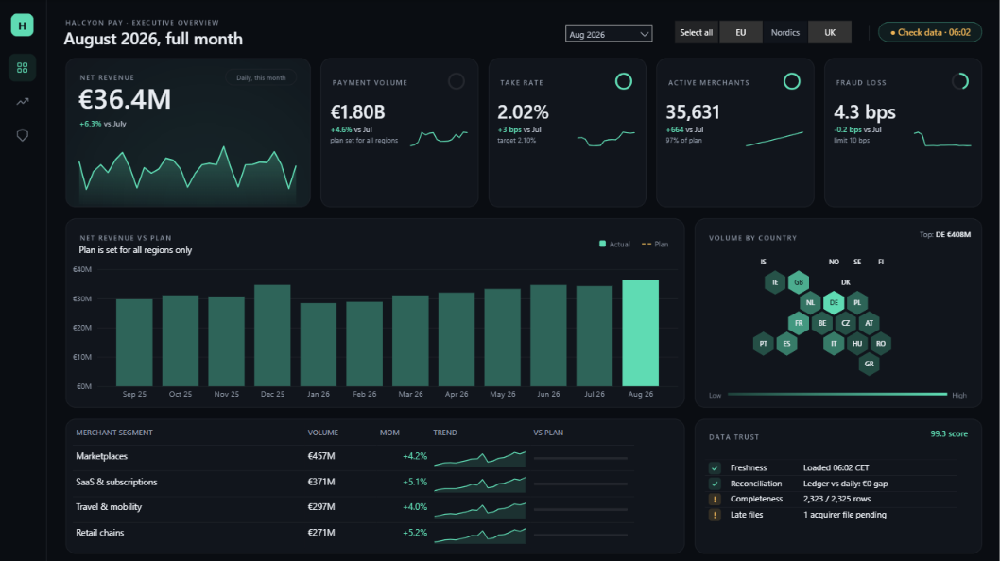
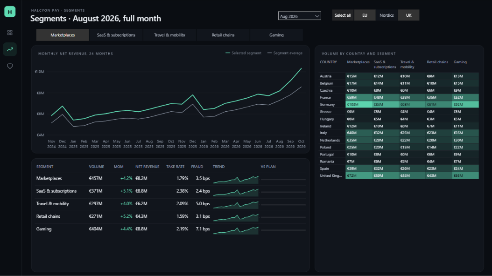
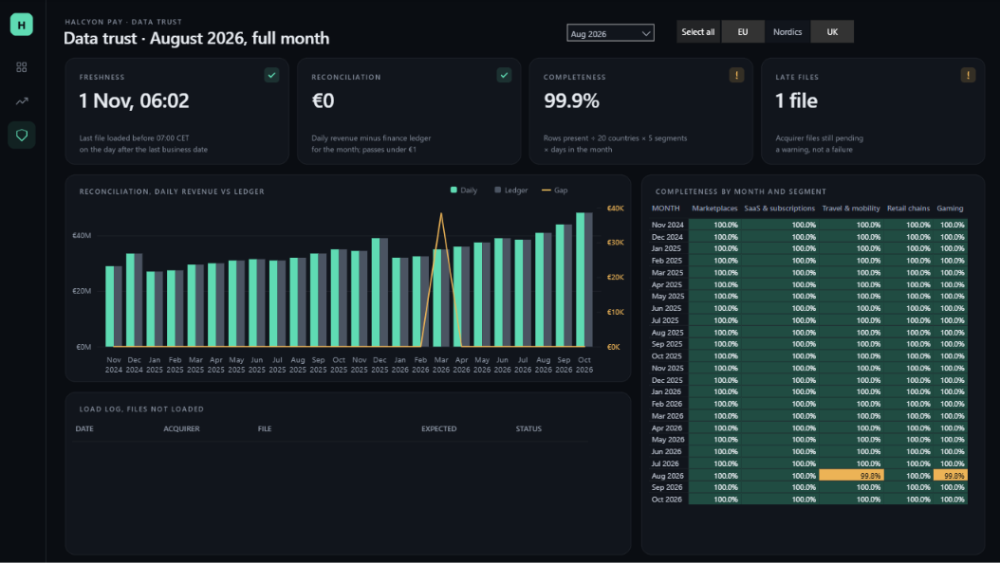

# Halcyon Pay – Executive Dashboard (Power BI)

A three-page executive dashboard for Halcyon Pay, a fictional European payment service provider. Dark, quiet layout; every micro-chart is drawn by DAX; the report checks its own data and says so on the first page.

All data is synthetic, made with a fixed seed by `generate.py`; Halcyon Pay is not a real company.



| Segments | Data trust |
|---|---|
|  |  |


## What is on the pages

- **Executive overview**: net revenue for the month with a daily trend, four KPI tiles (volume, take rate, active merchants, fraud loss) each with a progress ring and a 16-week spark, 12 months of revenue against plan, volume by country on a hex map, the segment table and the data trust panel.
- **Segments**: one segment against the average over 24 months, all five segments with take rate and fraud, and a country × segment heat matrix.
- **Data trust**: four checks (freshness, reconciliation, completeness, late files), the ledger reconciliation by month, a completeness heatmap and the load log of files that did not arrive.

The month slicer and the region chips are synced across pages. With no month selected, every page shows the latest month.

## How it's built

**Designed backgrounds.** Panels, rounded corners, the navigation rail, panel titles and legends are one PNG per page, drawn by `design/backgrounds.py` with Pillow. Native visuals sit on top with transparent backgrounds. The page looks designed, and Power BI has very little to draw.

**SVG measures.** Sparklines, rings, the hex map, bullet bars and status icons are DAX measures that return SVG text with the *Image URL* data category, shown in Image visuals and table columns. No custom visuals and no add-ons, so the file opens anywhere. The pattern and a template to reuse are in [docs/svg-measures.md](docs/svg-measures.md).

**Data trust in the product.** Freshness, reconciliation against the finance ledger, completeness and late files are DAX measures that run under the same filters as the visuals. The data carries four known issues, and each one is visible on page 3. Rules and thresholds: [docs/data-trust.md](docs/data-trust.md).

**Small model.** Import mode, one star schema: three dimensions, a 73,000-row daily fact, two monthly facts and a load log. No calculated columns on facts, single-direction relationships, 97 measures in display folders, each with a description. Details: [docs/model-and-measures.md](docs/model-and-measures.md). Visual positions: [docs/report-spec.md](docs/report-spec.md).

## Performance

Performance Analyzer in Power BI Desktop, cold cache, 1600 × 900:

| Page | Slowest visual | Total |
|---|---|---|
| Executive overview | – | – |
| Segments | – | – |
| Data trust | – | – |

## Run it

Requires Power BI Desktop (PBIP / PBIR enabled) and Python 3.11+.

```bash
pip install -r requirements.txt
python generate.py      # data/*.csv, tests/expected_kpis.csv, design/backgrounds/*.png
pytest                  # keys, ranges, the story in the data, planted issues
```

Open `powerbi/Halcyon_Executive.pbip`. If your clone is not in `C:\Users\jordy\Desktop12\github\pbi`, set the `DataFolder` parameter (Transform data > Edit parameters) to your `data\` folder, then refresh.

To check the model, run the queries in `tests/validation_queries.dax` against the open model (DAX query view or any tool that connects to Desktop). Each returns `expected`, `actual` and `pass`.

## Repo layout

```
generate.py                     data, expected KPIs and backgrounds (seed 2026)
data/                           6 CSV files
design/backgrounds.py           page backgrounds (Pillow)
design/design_reference.png     approved concept for page 1
powerbi/Halcyon_Executive.pbip  open this
powerbi/…SemanticModel/         TMDL
powerbi/…Report/                PBIR
powerbi/theme/halcyon_dark.json report theme
tests/                          data tests, expected KPIs, validation queries
docs/                           model, SVG measures, data trust, report spec, screenshots
```

## Licence

MIT
